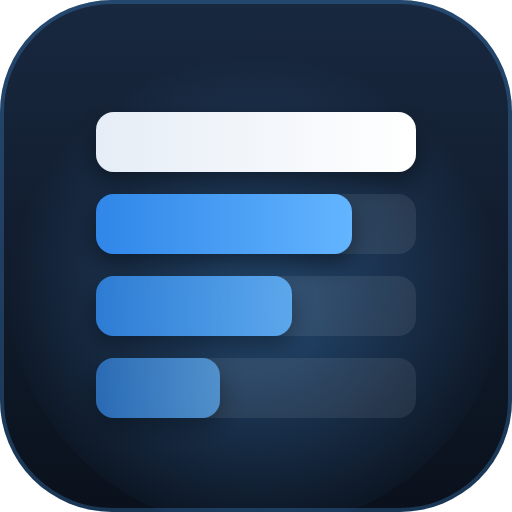

<p align="center"></p>

# DPSmeter | plugin Dalamud

Un HUD en jeu qui affiche en direct tes dégâts et ceux des membres de ton groupe dans Final Fantasy XIV. Le plugin est autonome : ni ACT ni aucun autre logiciel n'est nécessaire.

## Installation en jeu

1. En jeu, tape `/xlsettings` → onglet **Experimental**.
2. Dans **Custom Plugin Repositories**, colle ce lien, coche **Enabled**, clique sur **+** puis **Save** :
   ```
   https://raw.githubusercontent.com/Powerl3ss/DPSmeter/main/repo.json
   ```
3. Tape `/xlplugins`, cherche **DPSmeter** et installe-le.

## Fonctionnalités

**Le HUD**
- Une barre par joueur, du plus gros DPS au plus petit, à la couleur de son job.
- DPS, part des dégâts et, en option, dégâts totaux. Ta ligne est soulignée et reste visible même au-delà de la limite de lignes.
- Au survol : dégâts, taux de critiques et de coups directs, part des DoT, meilleures actions.
- Durée du combat et DPS du groupe dans l'en-tête.
- Largeur, taille du texte, opacité, couleurs, mode compact, position verrouillable, clics traversants.
- Masquage automatique hors combat ou hors instance.
- Aperçu avec de faux chiffres pour le placer sans se battre.
- Clic droit : menu rapide.

**La mesure**
- Démarre au premier coup porté, s'arrête toute seule à la sortie de combat.
- Au choix : toi seul, ton groupe (PNJ de soutien compris), ton alliance, ou tous les joueurs autour de toi.
- Familiers ajoutés à leur maître, Transcendance sur sa propre ligne (les deux sont réglables).
- Ripostes des tanks et ticks de DoT comptés.

**Le reste**
- Historique des combats de la session, avec le détail de chacun.
- Résumé en fin de combat dans le chat (visible par toi seul, désactivé par défaut).
- Option pour masquer le nom des autres joueurs.

## Précision des DoT

Le jeu annonce le montant de chaque tick, mais pas toujours qui l'a causé. Le plugin retrouve l'auteur grâce aux effets présents sur la cible. Si plusieurs joueurs sont possibles, le tick est partagé selon la puissance de leurs effets : le total du groupe reste exact, la part de chacun est une estimation, signalée dans l'infobulle.

## Commandes

| Commande | Effet |
|---|---|
| `/dps` | Affiche / masque le HUD |
| `/dps config` | Ouvre les réglages |
| `/dps end` | Termine le combat en cours |
| `/dps reset` | Efface le combat en cours et l'historique |
| `/dps debug` | Affiche les compteurs de diagnostic dans le chat |

`/dpsmeter` fonctionne aussi, si `/dps` est déjà pris par un autre plugin.

## Si rien ne s'affiche

Ouvre `/dps config` → **À propos** → **Diagnostic**. Si la lecture est inactive, le jeu vient sans doute d'être mis à jour : il faut attendre la mise à jour de Dalamud. Si elle est active mais que les compteurs restent à zéro pendant un combat, le format des paquets a probablement changé.

## Structure

```
DPSmeter/
├── Plugin.cs              point d'entrée : services, /dps, rafraîchissement de l'affichage
├── Configuration.cs       réglages sauvegardés
├── Combat/
│   └── CombatParser.cs    écoute les paquets du jeu et attribue chaque coup à un joueur
├── Core/                  logique sans dépendance au jeu (testée à part)
│   ├── Encounter.cs       un combat et ses combattants
│   ├── EncounterTracker.cs  début et fin des combats, historique
│   ├── EncounterView.cs   photo d'un combat, prête à afficher
│   ├── DotTable.cs        DoT connus et partage d'un tick
│   └── Formatting.cs      nombres, durées, infobulles, couleurs des jobs
├── images/                logo
└── Windows/
    ├── HudWindow.cs       le HUD affiché en jeu
    ├── ProgressBar.cs     barre animée (en-tête des réglages)
    └── ConfigWindow*.cs   les réglages (même base que DailyToDo)
Tests/DPSmeter.Tests/      tests de la logique : dotnet run depuis ce dossier
```
